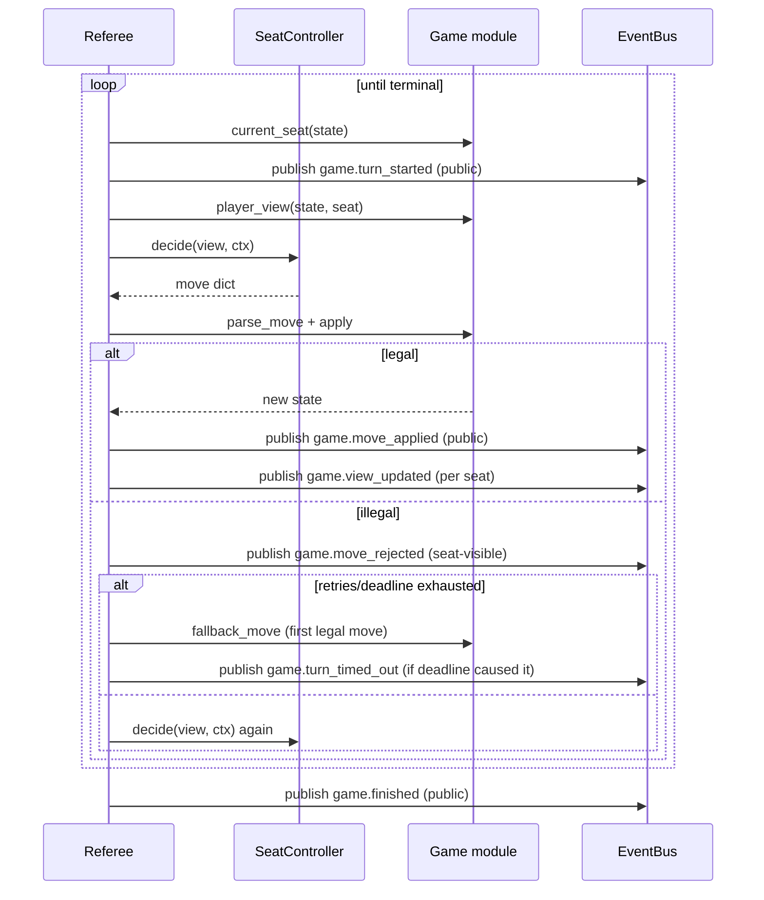

# Phase 3 — Deterministic referee, mixed seats

Status: done (PR #10, delivered together with Phases 4 and 5 on the same
branch), 2026-09-12.

Historical snapshot of `backend/app/referee/` as it stood when this phase
completed. Phases 4 and 5 (agent prompts and the LLM client) landed on the
same branch and PR but are documented separately —
`docs/architecture/phase-04-privacy-gate.md` and
`docs/architecture/phase-05-agent-client.md` — since each is its own
coherent piece of the system. Not updated for later changes; see
`docs/architecture/latest_architecture.md` for the referee as it stands
today.

## What was built

- **`SeatController`**: the one interface between the referee and whatever
  fills a seat — `async decide(view, ctx) -> dict`. Four implementations
  from this phase: `HumanController` (fed by a transport — unfed until
  Phase 8 wires one up), `PolicyController` and `ScriptedController` (tests
  and fallback behavior), and the LLM-backed `AgentController` (Phase 5).
  The referee never branches on *who* fills a seat — only `SeatSpec.kind`
  affects retry policy.
- **`Referee`**: owns turn order, move validation, state application, and
  win detection for one game, deterministic given a seed and move
  sequence. Every turn: publish `game.turn_started`, build the seat's
  `player_view`, ask its controller, then `parse_move` + `apply` as the
  validating step. A rejected move is published as `game.move_rejected`
  (seat-visible, carrying the reason) and, for non-human seats, counts
  against `max_retries`; human seats instead retry until the turn deadline.
  Exhausting retries or hitting the deadline plays `fallback_move` (the
  first legal move) and — only when a deadline caused it — publishes
  `game.turn_timed_out`.
- **`Referee.replay(slug, seed, seat_count, moves)`**: rebuilds a game's
  state from its `move_applied` event payloads. Built here, relied on
  starting three phases later when Phase 9 persistence needed to
  reconstruct any archived game's state from its durable move log.
- **`GameRunner`**: owns one asyncio task per room; `stop()` cancels it and
  the referee publishes `room.stopped`; `submit_move()` feeds a human seat.
- **Table talk**: the referee calls an optional `say` hook after each move
  and fans the resulting line out to every other controller's `hear` hook
  — this is what lets agents "hear" each other's chat without the referee
  itself having any chat-specific logic beyond the fan-out.
- **Event schema growth this phase**: `game.move_rejected`,
  `game.turn_timed_out`, `game.view_updated` newly added;
  `game.started`/`game.turn_started`/`game.move_applied`/`game.finished`
  gained additional fields to carry what the referee actually needed to
  publish.

## Key implementation decisions made during this phase

- **A human websocket message and an agent's parsed completion arrive as
  the same validated move shape** — `SeatController.decide` returns a
  plain `dict`, parsed by the *game's* `parse_move`, not the referee. This
  is what makes `DECISIONS.md` §3's "a seat is an abstraction" concrete:
  nothing downstream of `decide()` can tell a human seat from an agent
  seat by inspecting the move itself.
- **Retry policy differs by seat kind, not by a special case in the turn
  loop.** Agent/scripted seats get a bounded `max_retries` before falling
  back; human seats get unbounded retries until a wall-clock deadline —
  because an agent producing a malformed move in a loop is a bug worth
  giving up on quickly, while a human thinking through a decision is not.
  Both paths converge on the same `fallback_move` mechanism when exhausted.
- **`game.view_updated` is published once per seat, not once per move.**
  A privileged subscriber receives every seat's `view_updated`, which is
  what lets a future admin/focus view (Phase 10) render every seat's
  private view live; a player subscriber receives only its own — the same
  seat-visibility mechanism `docs/events.md` documents, exercised here for
  the first time by a real turn loop instead of hand-written test events.

## Turn loop



## Module layout introduced

```
backend/app/referee/
├── base.py or __init__.py   # SeatSpec, SeatController protocol, fallback_move
├── controllers.py            # HumanController, PolicyController, ScriptedController
├── referee.py                 # Referee: turn loop, replay
└── runner.py                  # GameRunner: one asyncio task per room, stop/submit_move
```

## Tests and what was verified

13 tests for this phase: every game finishes to completion with policy
seats and replays correctly from its own log; a human seat fed through the
runner produces the same final state as an equivalent scripted seat; agent
retry-then-fallback and human retry-until-deadline both exercised; player
subscribers proven to see only their own views through the event stream;
`stop()` proven to publish `room.stopped`.
