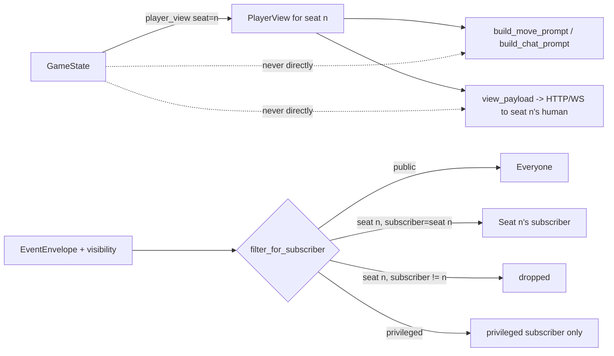

# Phase 4 — Privacy gate, prompt builder, human redaction

Status: done (PR #10, same branch as Phases 3 and 5), 2026-09-12.

Historical snapshot of the privacy boundary as it stood when this phase
completed. Not updated for later changes — see
`docs/architecture/latest_architecture.md` for the current state, and
`docs/agents.md`/`docs/events.md` for the living documentation of the
prompt builder and event visibility respectively.

## What was built

- **`app.games.move_schema`**: derives a self-contained JSON Schema for a
  game's move union directly from its `move_adapter` (the `TypeAdapter`
  every game exposes per its Phase 2 contract) — `$defs` inlined, titles
  stripped, every object closed with `additionalProperties: false`. This is
  what makes it possible to hand a model a schema it can use with either
  Ollama's `format` parameter or OpenAI's `response_format.json_schema`
  without per-model special-casing.
- **`app.agents.persona`**: six built-in `Persona`s (`name`, `risk`,
  `counts_cards`, `voice`, `chattiness`) — prompt-level traits only, per
  `DECISIONS.md` §7; the referee never reads them.
- **`app.agents.prompt`**: the actual privacy gate consumers. Both
  `build_move_prompt` and `build_chat_prompt` are built exclusively from a
  `PlayerView` and never see `GameState` at all — enforced by
  `tests/unit/agents/test_prompt.py` checking the function signatures and
  grepping the module source, not just by convention.
- **`app.api.views.view_payload(game, state, seat)`**: the one serializer
  the HTTP/websocket layer uses to send a human their own seat's view —
  the second (and, by design, only other) caller of `player_view` besides
  the prompt builder.
- **`tests/security/`**: a new dedicated test tree treating the privacy
  gate as a security boundary rather than an ordinary correctness concern
  — fuzzed prompts checked for any other seat's cards leaking in, and a
  full referee event stream checked the same way.

## Key implementation decisions made during this phase

- **One function, two callers, no third path.** `DECISIONS.md` §9
  registers the requirement ("one function is the only path from full game
  state to anything a seat sees"); this phase is where that became
  concretely true in code — `build_move_prompt`/`build_chat_prompt` for
  agents, `view_payload` for humans, and nothing else in the codebase is
  allowed to read `GameState` and hand any of it to a seat.
- **Enforcement lives in the test suite, not just in review.** Grepping the
  prompt-builder module for any reference to `GameState` (rather than
  trusting a docstring or a naming convention) is what makes this a
  boundary a future change can't accidentally violate without a test
  failing.
- **Move schema derivation from the existing `move_adapter`**, rather than
  hand-writing a parallel JSON Schema per game, means the LLM-facing schema
  and the actual move-parsing logic can never drift apart — they're
  generated from the same source.

## Event-visibility filtering flow

The privacy gate inside the referee/prompt path (`player_view`) and the
event-stream visibility filter (`filter_for_subscriber`, from Phase 1's
event schema) are two independent mechanisms enforcing the same rule from
different angles — one gates what goes *into* a prompt or an HTTP payload,
the other gates what comes *out* of the shared event stream. This phase is
where both were exercised together for the first time by a real referee
turn loop (Phase 3) instead of hand-written test fixtures:

Both paths converge on the same guarantee: no subscriber or prompt ever
sees another seat's hand, and `tests/security/` checks both paths directly
rather than assuming one implies the other.

## Tests and what was verified

Delivered as part of the same 13-test referee suite and the new
`tests/security/` fuzz suites described above: a test renders every game
at maximum seat count with a full chat backlog and asserts the resulting
prompt still fits `PROMPT_TOKEN_BUDGET` (3500 tokens, estimated as
`len(text) // 4`, dropping chat lines oldest-first and then the rules'
"How to think" section when over budget); fuzzed prompts and a full event
stream are checked for any other seat's cards across many random seeds.
