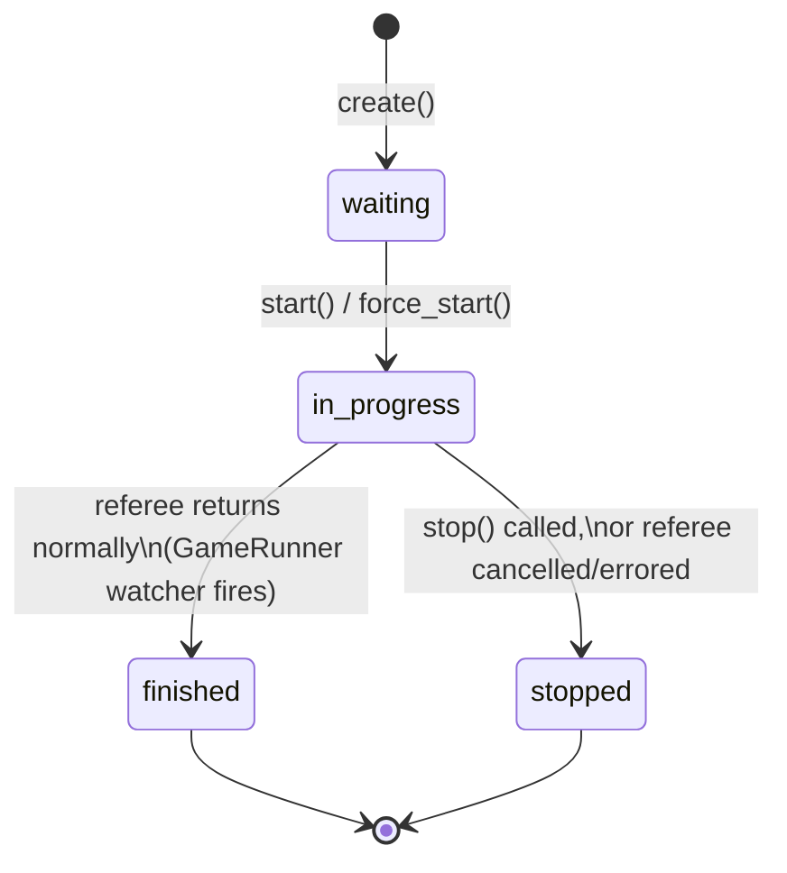

# Phase 7 — Rooms, seats, capacity, join queue

Status: done, branch `phase-7-rooms`, 2026-09-13. Two independent reviews
(correctness/concurrency, security) ran against this phase; their findings
and fixes are included below since they materially changed the shipped
code, not left in a separate pass.

Historical snapshot of `backend/app/rooms/` as it stood when this phase
(including its review fixes) completed. Not updated for later changes — see
`docs/architecture/latest_architecture.md` for the current state, and
`docs/rooms.md` for the living, continuously-updated documentation of the
room subsystem.

## What was built

Everything Phase 6's own writeup flagged as still needed: `RoomService`,
its HTTP routes, `SubscriptionGuard`, and `GameRunner`/`ModelRegistry`
lifespan wiring.

- **`RoomService`** (`app/rooms/service.py`): `create`, `get`,
  `list_public`, `join_by_code`, `leave`, `force_start`, `start`, `stop`,
  `capacity_check`, plus its own exception hierarchy (`RoomError`,
  `RoomFullError`, `RoomNotWaitingError`, `CapacityExceededError`).
  `start`/`force_start` assemble and run a genuinely live game: a real
  `Referee` via `GameRunner.start`, real (if still unfed —
  Phase 8's job) `HumanController`s, and real `AgentController`s backed by
  the real `ModelRegistry`. `create` grants the room's creator a
  room-scoped `moderator` role and publishes `RoomCreated`;
  `join_by_code` publishes `SeatFilled`.
- **`subscription_guard`** (`app/rooms/guard.py`): resolves visibility and
  own-seat identity for a room subscription — built and table-tested
  against every combination in its own docstring in this phase, ahead of
  Phase 8's real transport actually calling it.
- **HTTP routes** (`app/api/routes/rooms.py`): `POST /`, `GET /`,
  `GET /{room_id}`, `POST /join`, `POST /{room_id}/leave`, `POST
  /{room_id}/start`, `/force-start`, `/stop`, `GET /{room_id}/queue`.
  `CapacityExceededError` registered as a global exception handler (429,
  the same pattern `RateLimited` already used); a private room's
  existence is never leaked (403-vs-404 collapsed to always-404).
- **Lifespan wiring** (`app/main.py`): `app.state.runner` (`GameRunner`)
  and `app.state.model_registry` (`ModelRegistry`) created right after the
  event bus, torn down in the order runner → registry → bus.
- **Judgment calls** on the sync/async split the build brief left open,
  documented in code comments and `docs/rooms.md`: `create`,
  `join_by_code`, `force_start`, and `capacity_check` ended up `async def`
  (they publish events, await the join queue, or call another async
  method) even though the brief's illustrative signatures showed some of
  them as plain `def`; `get`, `list_public`, `leave`, and `seats` stayed
  sync.
- **Deferred, precisely**: the move-submission endpoint
  (`GameRunner.submit_move`) and any websocket/SSE transport are Phase 8's
  job. The join queue's `enqueue`/`offer_next` are not wired into
  `create`/`join_by_code`/`leave` in this phase — `capacity_check` and the
  `/join` 409 body only *read* `queue.snapshot`; nobody actually waits in
  line yet.

## Room lifecycle



The subtlety this phase's own review caught: nothing previously demoted a
naturally-finished game out of `"in_progress"`, permanently leaking a
concurrency slot. The fix (below) is what makes the `finished` transition
in this diagram actually reachable in the shipped code.

## Key implementation decisions made during this phase (initial build)

- **Capacity enforced only at `create()`, initially** — later corrected by
  review, see below.
- **A human seat's `user_id` may only ever be the creator's own id** at
  `create()` time; seating a different specific person goes through
  `invited_user_id` plus that person calling `join_by_code` themselves —
  avoiding a mass-assignment path where a room could be created with
  another user already silently "seated."
- **`join_by_code`'s fallback seat claim is one atomic conditional
  `UPDATE`**, not a prior `SELECT` followed by a write — so two callers
  racing for the same open seat can't both win it.

## Review fixes (two independent reviews: correctness/concurrency, security)

- **Room lifecycle gap (HIGH, correctness)**: nothing demoted a
  naturally-finished game out of `"in_progress"`, permanently leaking
  capacity. Fixed: `GameRunner.start(..., on_finished=...)` now spawns a
  watcher that fires exactly once when the game's task ends;
  `RoomService._finish_room` opens its own fresh session (the original
  request's session may be long closed) and moves a still-`"in_progress"`
  room to `"finished"` or `"stopped"`; `close()` awaits every pending
  watcher on shutdown.
- **Capacity bypass via `create()`-then-`start()` (CRITICAL, security)**: a
  caller could accumulate many `"waiting"` rooms within `create()`'s rate
  limit, then call the unthrottled `start()` on all of them, each
  triggering real outbound LLM calls. Fixed: `start()` re-checks capacity
  under a Postgres advisory transaction lock (`pg_advisory_xact_lock`),
  serializing the check-then-flip step across every worker process — this
  is the actual capacity enforcement point, not `create()`.
- **Mass assignment**: confirmed fixed as designed (`user_id` restricted to
  the creator's own id at creation).
- **Join-fallback reservation bug**: a joiner's fallback seat pick was
  taking a seat still reserved (`invited_user_id` set) for a *different*
  invitee. Fixed: the fallback explicitly excludes reserved seats, and the
  whole claim is the single atomic conditional `UPDATE` described above.
- **`subscription_guard` privacy bug**: `private`/`unlisted` rooms were
  falling back to the blanket `room:view` permission every default account
  holds, making "private" mean nothing more than "is a registered user."
  Fixed per `DECISIONS.md` §1.9's literal wording: `private` needs a seat,
  full stop; `unlisted` admits any authenticated caller (the link is the
  gate); `public` needs a seat or `room:view_public`.
- **`GET /{room_id}` seat-identity leak**: any caller merely clearing the
  visibility gate could see every seat's identity. Fixed: seat
  `user_id`/`invited_user_id`/`model`/`persona` redact to `null` except
  for the viewer's own seat or a privileged caller (creator or
  `room:view_seat_detail`).
- **Smaller fixes**: `_insert_room_with_unique_code` now retries only on
  the code's own unique-index collision, not any `IntegrityError`; a bad
  `room_id` on `grant_role`/`set_override` now 404s instead of surfacing an
  unhandled `IntegrityError`; a concurrent first read of an unseeded
  feature flag no longer raises; `force_start`'s seat backfill no longer
  commits ahead of `start()` succeeding.
- New tests added for every fix above, plus `tests/unit/referee/test_runner.py`
  for the completion watcher. **Full suite after fixes: 720 tests, gate
  clean.**

## Module/table layout introduced

```
backend/app/rooms/
├── service.py    # RoomService + its exceptions
└── guard.py        # subscription_guard

backend/app/api/routes/rooms.py
```

Tables: `room`, `room_seat` (both introduced this phase, per
`docs/rooms.md`'s schema section for the current, complete column list).

## Tests and what was verified

50 new tests at initial build (`tests/rooms/{test_room_service,test_rooms_api,test_guard}.py`
— 12 guard, 25 service, 13 HTTP), all passing against real Postgres +
Redis; full suite 705 tests at that point. After the review-fix pass
above: **720 tests**, ruff/ruff-format/mypy strict/ty/prek all clean.
